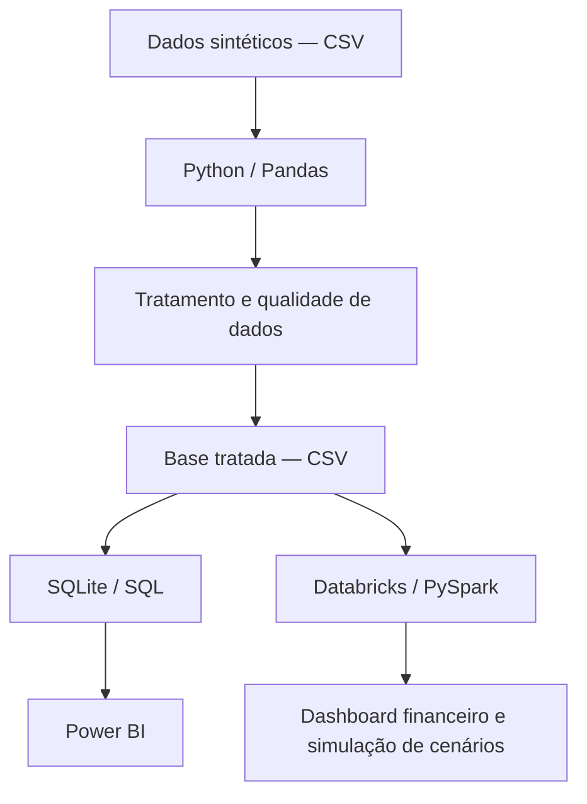

# Arquitetura de Dados — ISA Saúde Analytics

## 1. Visão geral

Projeto de Business Intelligence e Healthcare Analytics desenvolvido com dados sintéticos, para demonstrar competências em engenharia, qualidade, análise e visualização de dados em saúde.

## 2. Fluxo de dados

## 3. Camadas da arquitetura

### Ingestão
Leitura dos arquivos CSV com dados sintéticos de atendimentos.

### Processamento e qualidade
Padronização, tratamento de valores ausentes, identificação de duplicidades e cálculo de indicadores.

### Armazenamento
Persistência dos dados tratados e utilização do SQLite para consultas analíticas locais.

### Análise e transformação
Utilização de Python, SQL e PySpark para análises financeiras e simulação de cenários.

### Visualização
Construção de dashboards no Power BI e Databricks para apoiar a interpretação dos indicadores.

## 4. Indicadores financeiros

- Receita líquida
- Custos conhecidos
- Margem financeira
- Margem financeira percentual
- Margem por modalidade
- Sensibilidade financeira por cenário

Os indicadores de margem consideram somente registros com custos conhecidos, evitando tratar custos ausentes como zero.

## 5. Simulação de cenários

| Cenário | Receita | Custo |
|---|---:|---:|
| Base | 100% | 100% |
| Otimista | 105% | 95% |
| Pressão | 95% | 110% |

As simulações representam análises hipotéticas de sensibilidade financeira, não previsões estatísticas.

## 6. Governança e documentação

- `DICIONARIO_DADOS.md`: descrição das variáveis.
- `python/11_validar_projeto.py`: validações automatizadas.
- `requirements.txt`: dependências Python.
- `README.md`: apresentação e documentação geral.
- Git e GitHub: versionamento do código.

## 7. Observações

Todos os dados utilizados são fictícios e destinados exclusivamente à demonstração de competências técnicas.
